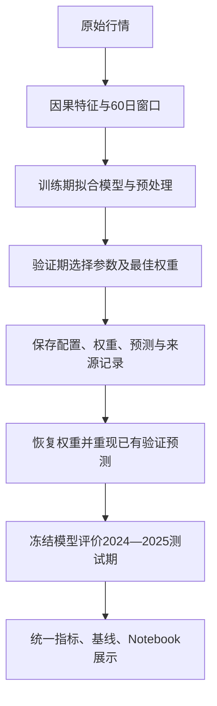

# AAPL / TSLA 五模型实验总结：以涨跌方向为重点

> 更新：2026-10-26。主要结果来自八特征、调优后 `compare_all_02` 的验证结果和对应 `final_test_02` 的最终测试结果。本文优先评价方向准确率与方向基线，收益误差作为补充。**这是报告重心的调整，不是训练协议的改变：已有模型仍以收益率回归训练，并按验证回归误差选择最佳轮次。** 本次只分析保存的预测，没有重训、调整阈值或改写实验结果。

## 1. 主要发现

1. **LightGBM 在两只股票最终测试中的方向准确率均为五模型最高，但领先简单基线的幅度不大。** AAPL 为 55.18%，高于训练期固定多数方向基线 0.80 个百分点，相当于净多判断对 4 天；TSLA 为 51.99%，高出 1.59 个百分点，相当于净多判断对 8 天。尚不能据此证明稳定的预测优势。
2. **PatchTST 的验证优势未延续到测试。** AAPL 从验证 54.49% 降至测试 49.60%，下降 4.89 个百分点；TSLA 从 52.89% 降至 47.61%，下降 5.28 个百分点。两只股票的平衡准确率也从高于 50% 变成低于 50%，说明退化不能只解释为涨跌比例变化。
3. **PatchTST 两只股票的错误模式不同。** AAPL 主要是上涨日识别率明显下降；TSLA 是上涨与不涨两类识别率同时下降，且测试退化主要集中于 2025 年。其 2025 年准确率为 43.20%，2024 年为 51.98%。
4. **不能笼统地说 TSLA 比 AAPL 更差。** TSLA 五模型测试原始准确率都低于各自在 AAPL 的准确率，但 TSLA 的多数方向基线也更低。LightGBM、XGBoost、PatchTST、LSTM 在 TSLA 相对多数基线的差距反而更好，GRU 更差；平衡准确率则呈现不同结果。评价角度必须明确。
5. **“测试不理想”主要指额外方向信息有限、跨时期稳定性不足。** 两只股票各只有 LightGBM 的准确率超过多数方向基线；XGBoost 和 GRU 的部分超过 50% 的成绩伴随强烈猜涨倾向。回归训练目标与当前关注的方向目标并不一致，也是解释结果的重要背景。
6. **原因不能只归结为“模型太复杂”或“股票波动大”。** 现有证据支持目标不一致、类别偏向、跨时期表现不稳定等诊断；有限样本、验证期选择偏差、特征信息不足及模型结构是否适配，是合理但尚未被隔离验证的解释。

## 2. 实验目标与数据

### 2.1 预测任务

在交易日 t 收盘后，使用截至 t 日的信息预测下一交易日收益：

```text
真实收益 y[t+1] = close[t+1] / close[t] − 1
预测上涨 = 预测收益 > 0
真实上涨 = 真实收益 > 0
```

平盘归入“不涨”。已有实验最初按照“预测收益率、辅助评价方向”设计，因此训练目标是收益率回归；当前训练损失并不是直接优化方向准确率或 F1。用户目前更关注方向判断，本文也单独突出方向结果，但不把已有实验描述为按方向准确率训练或选优的实验。

正式输入是 `data/AAPL_Apple_stock_data.csv` 和 `data/TSLA_Tesla_stock_data.csv`。程序自行计算特征，没有直接把已有 `with_features` 或 `standardized` 文件当作训练输入。历史检查发现现有 standardized 文件与全量完整行标准化一致，因而本项目改为仅用训练数据拟合缩放参数。数据检查细节见 [DATA_REVIEW.md](DATA_REVIEW.md)；其中早期“待办状态”是当时记录，不代表当前进度。

### 2.2 特征与历史窗口

每个样本包含最近 **60 个交易日 × 8 个特征**，股票与 Nasdaq 各四项：

| 特征 | 公式 | 含义 |
| --- | --- | --- |
| return | close[t] / close[t−1] − 1 | 当期收盘收益 |
| vol_change | volume[t] / volume[t−1] − 1 | 成交量相对变化 |
| intraday_return | close[t] / open[t] − 1 | 日内开盘到收盘的相对变化 |
| range | (high[t] − low[t]) / close[t] | 相对日内振幅 |

Nasdaq 特征加 `nasdaq_` 前缀。成交量使用变化率而非原始数量；所有输入随后按训练期统计量标准化。没有把高波动股票的输入简单除以常数来代替完整的训练期缩放。

### 2.3 时间划分

按**预测目标日期**分区，不是随机 8:1:1 划分。

| 分区 | 区间 | AAPL 样本数 | TSLA 样本数 | 用途 |
| --- | --- | --- | --- | --- |
| 训练 | 2010—2021 | 2960 | 2838 | 拟合模型、特征缩放和目标缩放 |
| 验证 | 2022-01-03—2023-12-29 | 501 | 501 | 选择超参数、最佳轮次/树前缀 |
| 最终测试 | 2024-01-02—2025-12-31 | 502 | 502 | 评价冻结后的模型 |
| 额外保留期 | 2026 年至 2026-08-27 | 未评价 | 未评价 | 仍保留，不纳入本文结果 |

训练有效目标日期受股票上市时间、60 日窗口及缺失值影响：AAPL 从 2010-04-01 开始，TSLA 从 2010-09-24 开始。

每个标签先与原始下一条交易记录绑定，再剔除无效窗口；不通过先删缺失行再 shift 的方式制造跨日标签。标准化使用训练窗口涉及的唯一历史日期，目标缩放仅使用训练标签。测试期沿用保存的统计量，不重新拟合。

## 3. 实验流程与结果来源



五种模型为 XGBoost、LightGBM、PatchTST、LSTM 和 GRU。树模型展开同一 60×8 窗口；序列模型保留时间与通道维度。模型输出都恢复到原始小数收益单位后评价。

测试为**逐日一步预测**：窗口可使用此前已经发生的测试期行情，但不含目标日及其之后信息。权重不会随测试期更新；这不是每个时间窗口重新训练的滚动验证。

本轮关键目录如下，来源以 `manifest.json` 为准：

| 阶段 | AAPL | TSLA |
| --- | --- | --- |
| 原参数验证 | `aapl_compare_all_01` | `tsla_compare_all_01` |
| 调优后验证（本文验证主表） | `aapl_compare_all_02` | `tsla_compare_all_02` |
| 原参数模型测试（调参迁移对照） | `aapl_final_test_01` | `tsla_final_test_01` |
| 调优后模型测试（本文最终测试主表） | `aapl_final_test_02` | `tsla_final_test_02` |
| 六特征探索，仅验证 | `aapl_nasdaq_less_01` | `tsla_nasdaq_less_01` |

本文已复算以上十个目录的逐日预测指标并与保存记录核对；对应前后实验的日期、真实标签和预处理参数也经过核对。测试目录记录的源配置/权重等文件指纹与对应验证实验一致，验证预测恢复检查通过。此核验支持结果链条一致，但不能替代数据商行情真实性与复权口径核查。

版本限制：`compare_all_01 → compare_all_02` 及八/六特征探索之间，`src/data.py`、`src/models/lightgbm.py`、`scripts/run_experiment.py` 的代码指纹有变化。虽然数据指纹、对齐日期、环境和相关预处理检查一致，仍应将其表述为**实验版本之间的比较**，不能保证所有差异都只由某个超参数或特征数量造成。

## 4. 本报告怎样评价方向能力？

### 4.1 方向准确率优先，但必须有参照

```text
方向准确率 = 正确判断涨跌的天数 / 全部有效目标日
基线以上提升（百分点）= 100 ×（模型准确率 − 固定多数方向准确率）
平衡准确率 =（上涨召回率 + 不涨召回率）/ 2
```

“上涨召回率”是在真实上涨日中正确猜涨的比例；“不涨召回率”是在真实不涨日中正确猜不涨的比例。平盘仍归入不涨，不删去小幅涨跌日，也不把预测零收益当作弃权。

多数方向根据**训练集**决定，再固定用于验证和测试。本项目两只股票的训练期多数方向都为上涨，所以其准确率等于各评价期真实上涨比例；不能在测试期重新选一个更有利的多数类。零收益基线始终预测不涨；训练均值基线在本项目也始终猜涨，但它与固定多数方向的定义不同。

平衡准确率用于补充判断类别偏向：当两类都存在时，始终猜一个方向的平衡准确率为 50%。它不是要替代用户关心的实际命中率，而是避免把更高的上涨比例误认成更强的方向识别能力。[scikit-learn 指标说明](https://scikit-learn.org/stable/modules/model_evaluation.html#balanced-accuracy-score)

### 4.2 先看数据中的方向基线

| 股票 | 阶段 | 天数 | 上涨天数 | 不涨天数 | 固定多数方向准确率 | 零收益方向准确率 | 前日收益方向准确率 |
| --- | --- | --- | --- | --- | --- | --- | --- |
| AAPL | 验证 | 501 | 257 | 244 | 51.30% | 48.70% | 50.50% |
| AAPL | 测试 | 502 | 273 | 229 | 54.38% | 45.62% | 52.59% |
| TSLA | 验证 | 501 | 259 | 242 | 51.70% | 48.30% | 52.50% |
| TSLA | 测试 | 502 | 253 | 249 | 50.40% | 49.60% | 49.00% |

AAPL 测试期上涨占 54.38%，TSLA 占 50.40%。因此 AAPL 得到 53% 的命中率仍未超过固定猜涨；TSLA 得到 52% 则略高于固定猜涨。不能用同一个 50% 门槛概括两只股票。

上涨 F1 也必须结合两类召回率理解。AAPL、TSLA 的“始终猜涨”测试 F1 分别约为 0.7045、0.6702，高于各自五模型，但这个策略完全不能识别不涨日。F1 较高并不等同于双向判断更好。

## 5. 五模型验证与最终测试：方向结果为主

### 5.1 调优后验证结果

每只股票内按方向准确率降序展示，同分不另作优劣判断。所有百分点差距均相对本阶段训练期固定多数方向基线。

| 股票 | 模型 | 方向准确率 | 高于多数基线(pp) | 平衡准确率 | 上涨 F1 | 预测上涨比例 |
| --- | --- | --- | --- | --- | --- | --- |
| AAPL | PatchTST | 54.49% | +3.19 | 53.97% | 0.6250 | 70.06% |
| AAPL | LightGBM | 51.50% | +0.20 | 50.64% | 0.6389 | 83.03% |
| AAPL | GRU | 51.10% | -0.20 | 50.25% | 0.6349 | 82.63% |
| AAPL | XGBoost | 50.70% | -0.60 | 49.61% | 0.6555 | 91.82% |
| AAPL | LSTM | 49.30% | -2.00 | 48.93% | 0.5621 | 64.47% |
| TSLA | LightGBM | 56.09% | +4.39 | 55.40% | 0.6405 | 70.46% |
| TSLA | PatchTST | 52.89% | +1.20 | 53.22% | 0.4892 | 40.52% |
| TSLA | GRU | 52.69% | +1.00 | 51.49% | 0.6550 | 85.43% |
| TSLA | XGBoost | 52.30% | +0.60 | 51.20% | 0.6438 | 82.24% |
| TSLA | LSTM | 52.30% | +0.60 | 52.06% | 0.5615 | 57.09% |

AAPL 验证中 PatchTST 为五模型最高，并比固定多数方向高 3.19 个百分点，相当于净多判断对 16 天；TSLA 验证最高的是 LightGBM，PatchTST 排第二，比多数基线高 1.20 个百分点，即净多判断对 6 天。因而 PatchTST 有验证期方向优势，但幅度有限，不能预先视为稳定规律。

### 5.2 调优后最终测试结果

| 股票 | 模型 | 方向准确率 | 高于多数基线(pp) | 平衡准确率 | 上涨 F1 | 预测上涨比例 |
| --- | --- | --- | --- | --- | --- | --- |
| AAPL | LightGBM | 55.18% | +0.80 | 52.63% | 0.6647 | 79.28% |
| AAPL | XGBoost | 52.79% | -1.59 | 49.06% | 0.6784 | 92.43% |
| AAPL | GRU | 52.39% | -1.99 | 48.73% | 0.6739 | 91.63% |
| AAPL | LSTM | 51.99% | -2.39 | 50.12% | 0.6181 | 71.31% |
| AAPL | PatchTST | 49.60% | -4.78 | 48.70% | 0.5600 | 60.16% |
| TSLA | LightGBM | 51.99% | +1.59 | 51.85% | 0.5922 | 67.33% |
| TSLA | XGBoost | 50.40% | +0.00 | 50.20% | 0.6054 | 75.30% |
| TSLA | LSTM | 49.40% | -1.00 | 49.25% | 0.5753 | 68.73% |
| TSLA | PatchTST | 47.61% | -2.79 | 47.67% | 0.4368 | 42.63% |
| TSLA | GRU | 47.61% | -2.79 | 47.30% | 0.6237 | 88.84% |

AAPL：LightGBM 的 55.18% 是五模型最高，平衡准确率为 52.63%；LSTM 虽然在收益回归上较好，方向准确率 51.99% 仍低于固定猜涨。XGBoost、GRU 的准确率超过 50%，但平衡准确率均低于 50%，提示类别偏向带来的表面优势。

TSLA：LightGBM 的 51.99% 是五模型最高，平衡准确率为 51.85%；XGBoost 与固定多数方向在总正确天数上持平，其他三模型低于基线。持平不意味着每天预测相同，而是改善与损失在该样本上抵消。

**两个股票中，只有 LightGBM 的五模型测试准确率高于各自固定多数方向基线。** AAPL 净多正确 4 天，TSLA 净多正确 8 天，这个数量比“超过 50%”更能说明实际优势有多小。一次测试领先不等于统计显著，也不等于可交易盈利。

### 5.3 同一调优后模型，从验证期到测试期如何变化？

| 股票 | 模型 | 验证准确率 | 测试准确率 | 准确率变化(pp) | 相对多数基线优势变化(pp) |
| --- | --- | --- | --- | --- | --- |
| AAPL | XGBoost | 50.70% | 52.79% | +2.09 | -0.99 |
| AAPL | LightGBM | 51.50% | 55.18% | +3.68 | +0.60 |
| AAPL | PatchTST | 54.49% | 49.60% | -4.89 | -7.97 |
| AAPL | LSTM | 49.30% | 51.99% | +2.69 | -0.39 |
| AAPL | GRU | 51.10% | 52.39% | +1.29 | -1.79 |
| TSLA | XGBoost | 52.30% | 50.40% | -1.90 | -0.60 |
| TSLA | LightGBM | 56.09% | 51.99% | -4.10 | -2.80 |
| TSLA | PatchTST | 52.89% | 47.61% | -5.28 | -3.99 |
| TSLA | LSTM | 52.30% | 49.40% | -2.89 | -1.59 |
| TSLA | GRU | 52.69% | 47.61% | -5.09 | -3.79 |

AAPL 除 PatchTST 外，其余四模型的原始准确率都有提高；但多数方向基线同时提高约 3.09 个百分点，因此 XGBoost、LSTM、GRU 相对基线的表现实际变弱，只有 LightGBM 相对基线略有增强。TSLA 五模型原始准确率均下降，且相对基线优势也都下降。

这与“调参前后比较”不同：本表比较的是**同一模型跨时期的表现**；第 9 节才比较原参数与调优后模型。验证与测试日期不同，不能把跨时期分数之差当成参数变化的因果效果。

## 6. PatchTST：验证优势为什么没有保持到测试？

### 6.1 退化同时出现在原始准确率与平衡准确率

| 股票 | 阶段 | 方向准确率 | 多数方向基线 | 高于基线(pp) | 平衡准确率 | 预测上涨比例 |
| --- | --- | --- | --- | --- | --- | --- |
| AAPL | 验证 | 54.49% | 51.30% | +3.19 | 53.97% | 70.06% |
| AAPL | 测试 | 49.60% | 54.38% | -4.78 | 48.70% | 60.16% |
| TSLA | 验证 | 52.89% | 51.70% | +1.20 | 53.22% | 40.52% |
| TSLA | 测试 | 47.61% | 50.40% | -2.79 | 47.67% | 42.63% |

AAPL 的基线以上优势由 +3.19 变为 −4.78 个百分点，下降约 7.97 个百分点；TSLA 由 +1.20 变为 −2.79，下降约 3.99 个百分点。注意：**TSLA 的原始准确率下降更大，但 AAPL 相对多数基线的优势损失更大**，因为 AAPL 测试期固定猜涨变得更容易。

### 6.2 用混淆矩阵定位错在哪里

“净多正确天数”相对始终猜涨计算：正确识别一个不涨日可多对一天，但把一个真实上涨日误判为不涨就少对一天，二者相减即为净收益。

| 股票 | 阶段 | 不涨→不涨 | 不涨→上涨 | 上涨→不涨 | 上涨→上涨 | 不涨召回率 | 上涨召回率 | 相对猜涨净多正确天数 |
| --- | --- | --- | --- | --- | --- | --- | --- | --- |
| AAPL | 验证 | 83 | 161 | 67 | 190 | 34.02% | 73.93% | +16 |
| AAPL | 测试 | 88 | 141 | 112 | 161 | 38.43% | 58.97% | -24 |
| TSLA | 验证 | 152 | 90 | 146 | 113 | 62.81% | 43.63% | +6 |
| TSLA | 测试 | 137 | 112 | 151 | 102 | 55.02% | 40.32% | -14 |

**AAPL：上涨日漏判增加，是主要退化位置。** 上涨召回率从 73.93% 降至 58.97%，而不涨召回率从 34.02% 升至 38.43%。模型不再像验证期那么偏向猜涨，预测上涨比例从 70.06% 降至 60.16%；但减少猜涨并没有带来足够多正确的不涨判断。测试中识别对 88 个不涨日，却漏掉 112 个上涨日，相对始终猜涨净少对 24 天。这里比较召回率比单看错误次数更合适，因为两阶段真实类别数量不同。

**TSLA：两类判断均退化，并非只因偏向不涨。** 不涨召回率从 62.81% 降至 55.02%，上涨召回率从 43.63% 降至 40.32%。预测上涨比例从 40.52% 升到 42.63%，依然较低，但上涨识别率反而下降，说明不能把问题简单理解为“猜涨次数不够”。测试中识别对 137 个不涨日，漏掉 151 个上涨日，相对始终猜涨净少对 14 天。

### 6.3 不是仅仅因为验证、测试的涨跌比例不同

准确率可写成：`上涨比例 × 上涨召回率 + 不涨比例 × 不涨召回率`。以下作一个算术分解：先保持验证期两类召回率，只替换为测试期类别比例；然后在该比例下分别替换两类召回率。三项之和严格等于实际准确率变化。它用于定位差异，不是因果实验，也不假定市场真的能独立改变某一项。

| 股票 | 仅类别比例变化贡献(pp) | 上涨召回率变化贡献(pp) | 不涨召回率变化贡献(pp) | 总准确率变化(pp) |
| --- | --- | --- | --- | --- |
| AAPL | +1.23 | -8.13 | +2.01 | -4.89 |
| TSLA | +0.25 | -1.67 | -3.86 | -5.28 |

两只股票的类别比例变化，按验证期识别率计算，本来都略有利于 PatchTST；真正拉低准确率的是两类识别率的变化，AAPL 尤其是上涨识别率下降。这比单说“测试期市场不同”更具体：**已有预测对涨跌的条件识别表现没有维持下来。** 但类别内具体样本也不同，该分解本身不能区分特征分布变化、关系变化、抽样波动或过拟合。

### 6.4 训练过程提供的解释线索

PatchTST 按标准化收益 MSE 保存最佳轮次，而不是按方向准确率。AAPL 最佳为第 4 轮、训练到第 10 轮早停；TSLA 最佳为第 2 轮、训练到第 8 轮早停。两者后续训练损失整体继续下降，验证损失却不再超过此前最佳值。这是继续拟合训练集没有带来验证收益的迹象，提示拟合与泛化之间存在张力；不能由此断言某一轮方向准确率最佳，也不能断言早停后还需要多训练一些就会改善测试。

现有训练记录没有逐轮方向准确率，也没有保存所有轮次的完整权重。因此本报告**不知道按方向选轮次能提高多少**，不能把改选优规则描述成已被验证的解决办法。

模型约有 20,097 个参数，每只股票只有约 2,800—3,000 个训练窗口，相邻窗口共享 59/60 个输入日期。样本并非完全独立，局部模式可能重复出现，模型可能学到对某些时期有效的关系。不过，参数数目与重叠本身不能证明过拟合，也不自动构成数据泄漏；目标日严格按时间划分，合法的历史输入可以跨分区边界。

本项目使用共享通道分块编码与联合标量回归头，60 日窗口、patch 长度 12、步长 6，每通道 9 个 patch；没有启用 RevIN 或预训练。分块建模有利于表达一段时间内的结构，但下一日涨跌未必主要由这些结构决定。这是任务适配假设，未做独立结构消融，不能断定某个组件缺失就是失败原因。原论文主要展示长期多变量预测，不能将本项目结果外推为原版 PatchTST 普遍无效。[PatchTST 原论文](https://arxiv.org/abs/2211.14730)

### 6.5 weight_decay 调整解释不了这个落差

本轮 PatchTST 的配置快照只把 `weight_decay` 从 0.01 改为 0.05。AAPL 验证方向准确率不变，TSLA 验证少判断对 1 天；两个股票测试方向准确率均不变。虽然收益 RMSE 有微小改善，但没有形成更多正确的方向判断，也没有修复跨时期退化。**相同准确率不保证逐日判断完全相同**，此处只描述总命中数。

## 7. AAPL 与 TSLA：哪里不同，哪里不能直接比较？

### 7.1 原始准确率较高，不等于额外预测能力更强

AAPL 测试上涨比例为 54.38%，比 TSLA 的 50.40% 高约 3.98 个百分点。模型只要大量猜涨，就更容易在 AAPL 得到较高原始准确率。因此需同时回答三个问题：实际猜对多少天、比固定多数方向多对多少天、对两类是否都能识别。

| 模型 | AAPL 准确率 | TSLA 准确率 | AAPL 高于基线(pp) | TSLA 高于基线(pp) | AAPL 平衡准确率 | TSLA 平衡准确率 |
| --- | --- | --- | --- | --- | --- | --- |
| XGBoost | 52.79% | 50.40% | -1.59 | +0.00 | 49.06% | 50.20% |
| LightGBM | 55.18% | 51.99% | +0.80 | +1.59 | 52.63% | 51.85% |
| PatchTST | 49.60% | 47.61% | -4.78 | -2.79 | 48.70% | 47.67% |
| LSTM | 51.99% | 49.40% | -2.39 | -1.00 | 50.12% | 49.25% |
| GRU | 52.39% | 47.61% | -1.99 | -2.79 | 48.73% | 47.30% |

- **LightGBM：** TSLA 的原始准确率和平衡准确率略低，但相对固定多数基线净多对 8 天，高于 AAPL 的 4 天；不能说 TSLA 在所有意义上更差。
- **XGBoost：** AAPL 准确率较高但平衡准确率低于 50%；TSLA 准确率与固定多数基线持平，平衡准确率略高于 50%。
- **PatchTST：** 两只股票测试平衡准确率都低于 50%；TSLA 原始命中率更低，AAPL 相对固定猜涨的亏损更大。两者都未显示稳健优势，错误类型不同。
- **LSTM：** AAPL 平衡准确率接近 50%，TSLA 略低；两者都没有超过固定猜涨，AAPL 的收益误差优势不能转换成方向优势的说法。
- **GRU：** TSLA 原始准确率、平衡准确率及基线以上差距均比 AAPL 差，是较一致的跨股票退化。

### 7.2 年度拆分：TSLA PatchTST 的困难主要在 2025 年

以下只把保存的测试预测按年份分组，不训练、不选参数；每年基线仍固定猜训练期多数方向“上涨”。年度结果是事后稳定性诊断，不能挑较好的一年来替代完整测试结果。

| 股票 | 年份 | 天数 | 多数方向基线 | XGBoost | LightGBM | PatchTST | LSTM | GRU |
| --- | --- | --- | --- | --- | --- | --- | --- | --- |
| AAPL | 2024 | 252 | 56.35% | 54.37% | 54.76% | 48.81% | 53.57% | 53.57% |
| AAPL | 2025 | 250 | 52.40% | 51.20% | 55.60% | 50.40% | 50.40% | 51.20% |
| TSLA | 2024 | 252 | 50.40% | 50.79% | 52.38% | 51.98% | 50.40% | 48.81% |
| TSLA | 2025 | 250 | 50.40% | 50.00% | 51.60% | 43.20% | 48.40% | 46.40% |

AAPL PatchTST 在 2024 年为 48.81%，2025 年为 50.40%，两年都低于各自固定猜涨基线；TSLA PatchTST 则从 2024 年的 51.98% 降到 2025 年的 43.20%，而这两年的真实上涨比例都约为 50.40%。**TSLA 的年度退化不能用总体涨跌比例变化解释。** 相同冻结模型在不同时间段适用性不同是直接观察，但尚不能确定是具体行情机制变化、输入分布变化还是样本偶然性所致。

LightGBM 在 TSLA 两年都略高于基线；AAPL 则 2024 年低于基线、2025 年高于基线。其全期排名第一也不代表每个年度都领先。

### 7.3 波动差异主要解释收益误差量级，不直接解释方向准确率

TSLA 测试日收益标准差约为 3.99%，AAPL 为 1.76%，前者约是后者 2.27 倍。这个事实会抬高 TSLA 的原始 RMSE，但**把收益整体乘以正数不会改变涨跌符号**，所以不能以更高波动直接解释方向判断更差。

较大或不对称的收益幅度可能通过平方误差训练影响模型，尤其当少数大幅涨跌对损失贡献很大时；但当前没有做相应受控实验，不能将它作为已经确认的因果解释。未分析新闻或公司事件数据，也不能把某个事件当作本次 TSLA 退化的原因。

## 8. 为什么最终测试的方向表现整体不理想？

这里把“直接证据”“可能机制”与“尚不能确定的部分”分开。现有结果不足以给出唯一原因，更合理的是多个因素共同作用。

### 8.1 已确认的任务不一致：模型优化收益误差，报告关注方向命中

五模型都输出连续收益率。XGBoost、LightGBM 使用回归目标并按验证 RMSE 早停；三个神经网络使用 MSE 并按验证 MSE 保存最佳权重。方向由输出是否大于零得到，它没有直接参与原来的最佳轮次选择。

这不只是展示顺序的差别。平方误差关注数值和幅度，准确率则对每个交易日只计对或错。即使模型学到了理想的平均收益预测，其符号也未必等于最常出现的方向。例如一个**假设分布**：60% 概率涨 1%，40% 概率跌 2%，平均收益为 −0.2%，但更常见的方向是上涨。这个例子不是对本项目收益分布的估计，只说明两个目标可以从根本上不一致。

因此，RMSE 调参有改善而方向没有改善并不矛盾；LSTM 在 AAPL 测试回归较好却未超过方向基线，也不矛盾。另一方面，目标不一致不能独自解释全部跨时期退化，因为 LightGBM 在相同回归框架下仍有小幅方向优势。

### 8.2 已确认的类别偏向：模型不一定同时擅长涨和不涨

| 股票 | 模型 | 上涨召回率 | 不涨召回率 | 预测上涨比例 |
| --- | --- | --- | --- | --- |
| AAPL | XGBoost | 91.58% | 6.55% | 92.43% |
| AAPL | LightGBM | 81.68% | 23.58% | 79.28% |
| AAPL | PatchTST | 58.97% | 38.43% | 60.16% |
| AAPL | LSTM | 71.43% | 28.82% | 71.31% |
| AAPL | GRU | 90.48% | 6.99% | 91.63% |
| TSLA | XGBoost | 75.49% | 24.90% | 75.30% |
| TSLA | LightGBM | 69.17% | 34.54% | 67.33% |
| TSLA | PatchTST | 40.32% | 55.02% | 42.63% |
| TSLA | LSTM | 67.98% | 30.52% | 68.73% |
| TSLA | GRU | 86.17% | 8.43% | 88.84% |

最明显的是 AAPL XGBoost、GRU：约 92% 的日子预测上涨，上涨召回率超过 90%，但不涨召回率只有约 6.55%、6.99%。这类预测在上涨略多的区间容易获得超过 50% 的准确率，却没有超过固定猜涨。TSLA GRU 也预测上涨约 88.84%，不涨召回率仅 8.43%。

这些是从混淆矩阵直接观察到的偏向。一个可能机制是：在信息较弱、回归输出较保守时，预测接近正的训练均值，多数输出落在零以上；但不能仅凭猜涨比例确认内部机制。样本类别也并非极端失衡，不能把所有问题简单归咎于“数据严重不平衡”。

### 8.3 已确认的时间外推难度，尚未定位具体分布变化

训练数据止于 2021 年，验证使用 2022—2023 年，测试延伸到 2025 年。测试虽逐日使用最新可见输入，但权重和标准化统计量没有滚动更新，也没有把验证样本重新加入拟合。它检验的是旧模型对后续时期的适用性，不能期待随着新数据出现自动适应。

TSLA 五模型从验证到测试均下降、PatchTST 的类别识别率和年度表现变化，说明当前方法的优势未稳定跨期保留。可能涉及输入分布、输入与目标的关系变化或抽样波动；本报告只测量了输出表现和部分标签统计，**没有完成输入漂移或条件分布变化检验**，因此不把“市场分布漂移”作为已被证明的单一原因。

固定训练、独立测试本身是合理设计，并非错误；不重新拟合验证集也符合本项目冻结测试约定。它揭示的是方案的适用边界，而非模型恢复一定出了问题。

### 8.4 验证集同时参与早停和调参，优势可能偏乐观

各模型反复参考同一段验证历史选择参数与轮次，某些候选可能刚好适合那两年。即使没有直接使用验证标签计算训练梯度，验证表现仍参与了选择过程；获选模型的分数不等于完全独立评价。

PatchTST 在 AAPL 验证只比固定猜涨净多对 16 天，TSLA 净多对 6 天。这样的小优势更需要跨时期、跨种子确认，而不能仅凭一次最高分认定稳定信号。不过，我们没有各组员完整搜索次数与全部候选记录，不能量化选择偏差，也不能断言所有下降都由调参过拟合造成。更强的模型选择验证应保留时间顺序，在开发历史内设置多个先训练后验证的区间。[时间序列验证说明](https://scikit-learn.org/stable/modules/cross_validation.html#cross-validation-of-time-series-data)

### 8.5 有限样本、共同特征与模型结构，可能共同限制可学习信号

每只股票实际只有约三千个训练窗口，相邻窗口高度重叠。增加模型层数或树的数量不等于增加独立信息；表达能力越强，也可能越容易表达局部偶然关系。

所有模型只使用个股与 Nasdaq 的历史价量衍生特征，没有公司事件、新闻或其他外部信息。五种结构最终都没有形成很大的稳定方向优势，提示**共同的输入信息或评价协议可能也是限制因素**，不能只归咎于 PatchTST 架构。不过，这不能证明现有八特征完全没有信息，也不能保证补充新闻一定有效，需要独立验证。

| 模型 | 与结构有关的合理解释 | 当前证据支持到哪里 |
| --- | --- | --- |
| XGBoost | 展开的窗口通过树分裂表达非线性条件；正则化下的回归输出可能偏保守 | 直接观察到猜涨倾向及基线附近准确率；尚未用叶节点或特征归因确认原因 |
| LightGBM | 树模型可能捕捉到部分与正负号有关的组合模式 | 两股票测试准确率及平衡准确率最高，但净优势小，不能证明结构普遍最好 |
| PatchTST | 分块注意力可能拟合局部时序关系，有限样本与次日方向任务未必能发挥其优势 | 类别识别率和跨年表现退化明确；缺少结构消融，不能定位某个组件 |
| LSTM | 循环状态可概括历史，但学习收益幅度不等于学习更高命中率 | AAPL 回归改善与方向不领先并存；不能直接归因于一层结构或平滑效果 |
| GRU | 回归输出偏向一侧时，较简单的循环结构也可能主要猜多数方向 | 高预测上涨比例和低不涨召回率明确；不能把失败归因于门控结构本身 |

### 8.6 评价样本有限，不能把微小领先或落后当成稳定规律

每只股票测试只有 502 天，多判断对 1 天就改变准确率约 0.20 个百分点。LightGBM 的基线以上净优势分别仅 4 天和 8 天；这些是配对预测正确数的净差，并不表示只有这些天的预测与基线不同。

尚未执行考虑时间依赖的置信区间或配对显著性检验，也没有正式多随机种子重复。不能把低于 50% 的 PatchTST 简单反向使用并宣称找到有效策略：那会依据已查看的测试结果制定新规则，仍需独立验证。测试不理想也不等于“所有模型完全没有任何信息”，目前能支持的是**没有展示出足够稳定、充分验证的方向优势**。

### 8.7 数据口径是待核实项，不是可以随意使用的解释

数据生成脚本、Nasdaq 具体代码、拆股及分红调整口径仍未完整取得。收益直接按保存的 close 计算，不能宣称是含分红总收益。结果文件内部一致、验证恢复通过，支持读取与模型来源正确；但不能替代原始行情口径核查。

因此不能在未发现具体数据错误的情况下，把测试表现不好归咎于“数据有问题”。当前确认的是模型输出质量和泛化表现有限；数据问题是需要进一步排查的可能因素。

## 9. 本轮调参与六特征探索：从方向角度回看

### 9.1 调参前后方向准确率

本表比较同一阶段、相同目标日上的原参数与调优后结果；与第 5.3 节的跨时期比较不同。“变化”单位为百分点。

| 股票 | 模型 | 原验证 | 调优后验证 | 验证变化(pp) | 原测试 | 调优后测试 | 测试变化(pp) |
| --- | --- | --- | --- | --- | --- | --- | --- |
| AAPL | XGBoost | 50.30% | 50.70% | +0.40 | 52.79% | 52.79% | +0.00 |
| AAPL | LightGBM | 51.10% | 51.50% | +0.40 | 54.18% | 55.18% | +1.00 |
| AAPL | PatchTST | 54.49% | 54.49% | +0.00 | 49.60% | 49.60% | +0.00 |
| AAPL | LSTM | 51.30% | 49.30% | -2.00 | 54.38% | 51.99% | -2.39 |
| AAPL | GRU | 51.50% | 51.10% | -0.40 | 53.19% | 52.39% | -0.80 |
| TSLA | XGBoost | 50.90% | 52.30% | +1.40 | 50.60% | 50.40% | -0.20 |
| TSLA | LightGBM | 53.69% | 56.09% | +2.40 | 50.20% | 51.99% | +1.79 |
| TSLA | PatchTST | 53.09% | 52.89% | -0.20 | 47.61% | 47.61% | +0.00 |
| TSLA | LSTM | 51.70% | 52.30% | +0.60 | 50.40% | 49.40% | -1.00 |
| TSLA | GRU | 52.30% | 52.69% | +0.40 | 51.39% | 47.61% | -3.78 |

LightGBM 两只股票的方向准确率在验证和测试均有所提高；这是本轮最一致的方向改善，但仍不能保证未来保持。LSTM 的方向改善不一致，GRU 的测试方向准确率均下降。PatchTST 增强 weight decay 没有提高测试命中数，不能称为方向任务上的有效改进。

原参数与调优后模型均已查看测试成绩。此表用于归档，不据此重新选择某组参数后再把同一测试期称为全新独立评价。代码版本差异也已在第 3 节说明，不能把所有变化归因于单个参数。

### 9.2 配置快照中的主要变动

两只股票本轮所列配置变动一致；没有字段的旧配置记为“未显式指定”，不把它擅自解释成某个默认数值。

| 模型 | 配置差异 |
| --- | --- |
| XGBoost | `early_stopping_rounds`：30 → 80<br>`n_estimators`：400 → 800<br>`reg_alpha`：未显式指定 → 0.15 |
| LightGBM | `colsample_bytree`：0.8 → 0.85<br>`early_stopping_rounds`：30 → 80<br>`learning_rate`：0.03 → 0.0475<br>`max_bin`：未显式指定 → 127<br>`max_depth`：4 → 6<br>`min_child_samples`：50 → 28<br>`min_split_gain`：未显式指定 → 1.0<br>`n_estimators`：500 → 1500<br>`num_leaves`：15 → 52<br>`reg_alpha`：0.0 → 0.01<br>`reg_lambda`：10.0 → 0.1<br>`subsample`：0.8 → 0.85 |
| PatchTST | `weight_decay`：0.01 → 0.05 |
| LSTM | `batch_size`：64 → 32<br>`dropout`：0.2 → 0.1<br>`hidden_size`：64 → 32<br>`learning_rate`：0.0005 → 0.002<br>`num_layers`：2 → 1 |
| GRU | `batch_size`：64 → 32<br>`epochs`：30 → 50<br>`learning_rate`：0.0003 → 0.0005<br>`patience`：6 → 8<br>`weight_decay`：0.01 → 0.0001 |

### 9.3 六特征探索仅作为开发期记录

该探索将 Nasdaq 四项输入缩减为收益率和成交量变化率，总输入由八特征变为六特征，使用原参数版本。下面比较其相对原八特征验证方向准确率的变化，正数表示六特征更高。

| 模型 | AAPL 方向变化(pp) | TSLA 方向变化(pp) |
| --- | --- | --- |
| XGBoost | +1.00 | +1.80 |
| LightGBM | -1.60 | -1.20 |
| PatchTST | -3.39 | -1.80 |
| LSTM | +0.60 | +0.00 |
| GRU | +1.40 | -0.60 |

特征精简没有对五模型、两股票产生统一的方向改善。此次正式调参与测试使用八特征，没有六特征最终测试；还存在已注明的代码版本差异，因此不能将这个探索视为完全隔离其他因素的因果实验，也不能据此说 Nasdaq 信息一定过多。

## 10. 补充评价：收益幅度是否预测得好？

方向正确不代表收益幅度准确，因此保留回归指标，但不据此决定本报告的整体优胜模型。MAE、RMSE 越低越好；数值为小数收益单位，0.01 对应 1 个百分点。R² 相对评价期均值计算，R² vs zero 相对零收益预测计算，后者大于零才说明平方误差低于零收益基线。

| 股票 | 模型 | 验证 RMSE | 测试 RMSE | 测试 MAE | 测试 R² | 测试 R² vs zero |
| --- | --- | --- | --- | --- | --- | --- |
| AAPL | XGBoost | 0.018198 | 0.017696 | 0.011663 | -0.010467 | -0.008167 |
| AAPL | LightGBM | 0.018042 | 0.017842 | 0.011723 | -0.027165 | -0.024826 |
| AAPL | PatchTST | 0.018712 | 0.018372 | 0.012623 | -0.089154 | -0.086674 |
| AAPL | LSTM | 0.018295 | 0.017030 | 0.011437 | 0.064217 | 0.066348 |
| AAPL | GRU | 0.018323 | 0.017587 | 0.011596 | 0.001928 | 0.004201 |
| TSLA | XGBoost | 0.038198 | 0.039935 | 0.029056 | -0.000576 | 0.001851 |
| TSLA | LightGBM | 0.037813 | 0.040468 | 0.029446 | -0.027473 | -0.024982 |
| TSLA | PatchTST | 0.038874 | 0.041627 | 0.030624 | -0.087154 | -0.084518 |
| TSLA | LSTM | 0.038232 | 0.040260 | 0.029149 | -0.016924 | -0.014458 |
| TSLA | GRU | 0.038433 | 0.040041 | 0.029011 | -0.005898 | -0.003459 |

| 股票 | 测试零收益 RMSE | 测试训练均值 RMSE | 测试前日收益 RMSE |
| --- | --- | --- | --- |
| AAPL | 0.017624 | 0.017608 | 0.024307 |
| TSLA | 0.039972 | 0.039928 | 0.056904 |

- AAPL LSTM 的测试 MAE、RMSE 为五模型最低，但方向准确率没有超过固定猜涨。此前对平方误差的事后分解显示：按真实收益绝对值选择的最大 10 个波动日，贡献了其相对零收益全期平方误差净改善的约 96.73%。这解释了“误差表现突出”为什么不能自动推出“多数交易日方向更准”；没有删除这些日期，也不因此否定回归改善的价值。
- TSLA XGBoost 的测试 RMSE 为五模型最低，仍略逊于训练期平均收益基线。TSLA 的绝对误差也受更高收益波动影响，不据此给方向能力排序。
- AAPL PatchTST 的测试 RMSE 0.018372 甚至低于验证的 0.018712，但方向准确率从 54.49% 降至 49.60%。这是两个评价目标不同的实际例子，不能只看绝对 RMSE 判断方向泛化。
- PatchTST 在 AAPL 的预测与真实收益 Pearson 相关由验证约 +0.0816 降至测试 +0.0035，TSLA 从 +0.0568 降至 −0.0430。这是幅度关系变弱的补充描述，不等价于方向准确率，也不证明存在可稳定反向利用的关系。

## 11. 当前结论与后续工作边界

当前选择是**只调整报告重心**，所以不修改训练损失、早停规则、五模型权重、输入特征或预测阈值；也不需要为了展示方向指标重新训练。报告应明确说明：这些是回归模型的方向表现，而非专门为方向准确率优化的分类实验。

本轮优先完成以下可交付内容：

1. 统一用方向准确率、固定多数方向基线、平衡准确率、两类召回率和预测上涨比例解释测试结果，保留 RMSE 为补充。
2. 将 PatchTST 验证—测试落差、TSLA 的年度变化及模型猜涨倾向如实写入结论；不要只挑最好股票、最好年份或最好指标。
3. 补齐数据来源与组员实际调参记录，保存最终配置、模型来源、版本差异和随机种子，便于合并与复核。

如果以后另开一轮研究，可以在现有开发历史内部采用多个按时间推进的验证区间、配对多种子实验，必要时比较按方向选优或分类目标。只有受控比较才能检验本报告提出的原因假设。**这些是后续研究建议，不是本次已执行或必须立即实施的改动。**

2024—2025 年测试结果已查看，不能再据此反复调参数或阈值并称为独立最终检验。2026 年保留期尚未评价；若将来使用，应先核实数据完整性并冻结研究协议。尚未进行时间依赖下的统计显著性检验或交易回测，不把小幅准确率提升解释成稳定获利。

## 12. 文件导航与可复核材料

- [README.md](README.md)：环境、训练/验证/测试命令与结果格式。
- [PROJECT_PLAN.md](PROJECT_PLAN.md)：共同实验约定、分工与交付。
- [超参数前后验证对比](notebooks/hyperparameter_tuning_comparison.ipynb)：比较 `compare_all_01 → compare_all_02`。
- [调优后五模型测试展示](notebooks/01_final_test_results.ipynb)：当前 `RUN_NAMES` 指向两只股票的 `final_test_02`。
- [原参数五模型测试展示](notebooks/02_final_test_results.ipynb)：当前 `RUN_NAMES` 指向两只股票的 `final_test_01`。文件名数字与实验数字并不相同，使用时核对开头的目录设置。
- [Nasdaq特征探索](notebooks/nasdaq_feature_comparison.ipynb)：六特征与八特征验证对比。

精确值以 `artifacts/<实验目录>/metrics.json` 为准，逐日核验依据是 `predictions.csv`；配置来自该目录 `config.json`，不是当前 `configs/`。测试来源由 `manifest.json`、`source_manifest.json`、`validation_replay.json` 记录，训练曲线来自源验证目录 `training.json`。表格为显示而四舍五入，因此极小差异应查看原始数值。

`artifacts/` 被 Git 忽略；本文可随代码共享，但组员若要运行 Notebook 和复核结果，需要另行取得对应实验结果包。


两个最终测试 Notebook 现已按方向优先展示；文件编号不等于实验编号，应以 `RUN_NAMES` 与源实验记录为准。本文补充的平衡准确率、两类召回率、百分点差距和年度结果由保存的预测及混淆矩阵推导，不修改原始 `metrics.json`。
